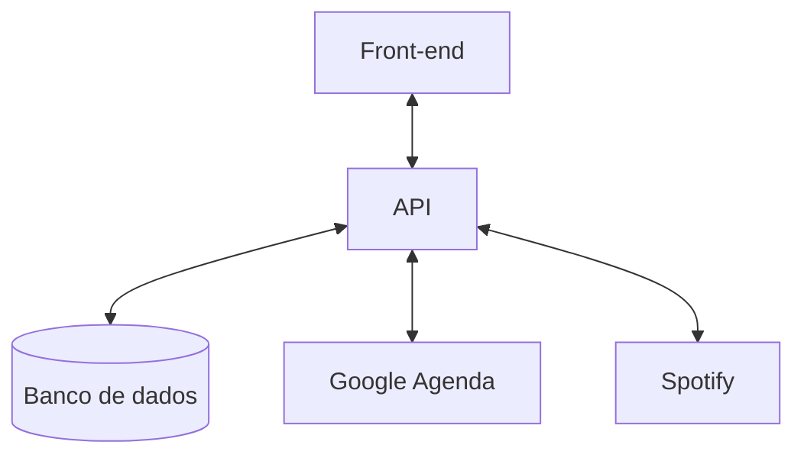

# Design Doc: Uptake

- **Autor:** Luis Miguel Oliveira de Almeida Mackiewicz
- **Última atualização:** 22/10/2026

---

## 1. Contexto e Objetivo

O **Uptake** é um sistema criado para ajudar estudantes de concurso público com ferramentas necessárias para a organização de seus materiais, provas e ciclo de estudos.

### Metas

- Permitir que o usuário gerencie anotações, ciclo de estudos, provas e tarefas (To-Do).
- Integrar com o Google Agenda e o Spotify.
- Disponibilizar Pomodoro Timer para controle de tempo de estudo.

### Não-metas (Fora de escopo inicial)

- Aplicativo mobile nativo e desktop na v1.
- Compartilhamento público de cadernos/anotações entre usuários.

---

## 2. Arquitetura Geral

