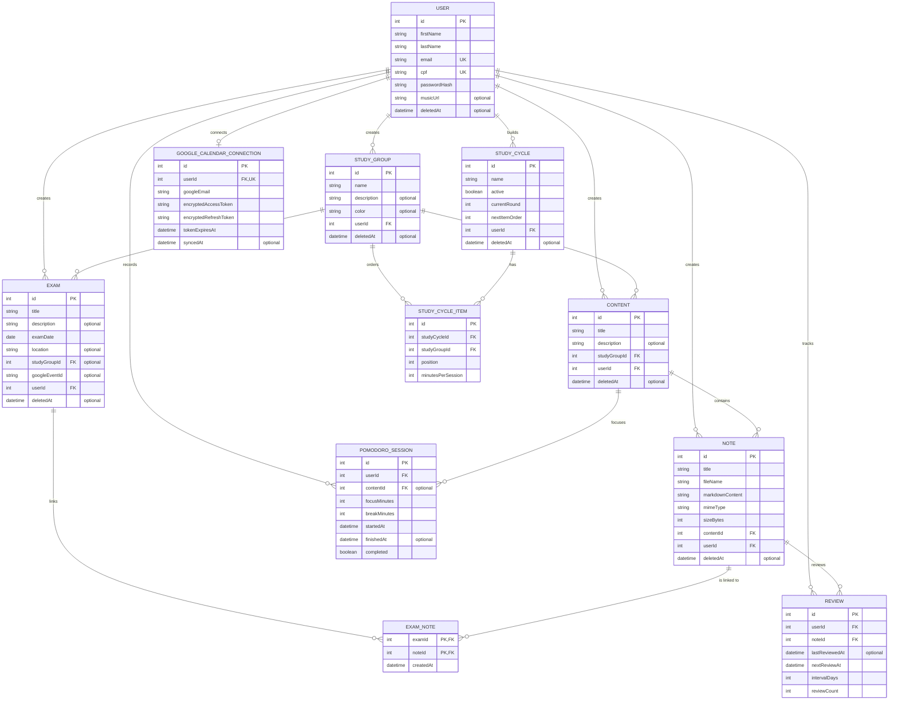

# Modelo de dados do Uptake

Este documento complementa a seção 8 do [PRD](./PRD.md) e registra as decisões do modelo implementado em `api/prisma/schema.prisma`. Todos os nomes de modelos, tabelas e colunas são em inglês; a explicação permanece em português.

## Decisões principais

1. **Arquivo e anotação são a mesma coisa.** A entidade `Note` guarda o conteúdo de um arquivo `.md`: `fileName`, `markdownContent` (`LONGTEXT`), `mimeType` (`text/markdown`) e `sizeBytes`. O texto fica no banco por ser fácil de ler, editar e buscar; não há servidor de arquivos no MVP.
2. **Caminho do conteúdo:** `StudyGroup → Content → Note` (RD-01 e RD-02). Um grupo `History` pode ter vários conteúdos, e cada conteúdo pode ter vários `.md`, como `brazil_history.md` e `independence.md`.
3. **Exam pode vincular várias Notes, de grupos diferentes** (RF-07). A tabela `ExamNote` resolve o N:N com chave primária composta. Assim, a prova de 28/01/2027 pode usar notas de History, Math e Physics.
4. **Exam também pode pertencer a um StudyGroup** (`studyGroupId` opcional), conforme RD-03.
5. **Isolamento por usuário:** todo registro tem `userId`. Toda consulta deve filtrar `userId = usuário autenticado` **e** `deletedAt = null`.
6. **Exclusão lógica (RD-04):** nenhum `DELETE` físico. Excluir um grupo marca `deletedAt` nele e, em cascata lógica, em seus conteúdos e notas. Vínculos em `ExamNote` são preservados como histórico, mas notas excluídas não aparecem nas listagens. Por isso todas as relações usam `onDelete: Restrict`. Como as chaves únicas continuam valendo para linhas excluídas, um cadastro repetido **reativa** a linha existente (limpa `deletedAt`) em vez de inserir duplicata.
7. **Música ambiente** (RF-11) fica em `User.musicUrl`; não há tabela própria.
8. **Google Calendar** (RF-13): a conexão OAuth por usuário fica em `GoogleCalendarConnection`, com tokens criptografados pela aplicação. O `googleEventId` em `Exam` guarda o evento remoto correspondente.
9. **Paginação:** `page` começa em 1, padrão de 20 itens por página e máximo de 100, para todas as listagens (RT-02).

## Dicionário de nomes

| Português | Inglês (modelo/tabela) |
| --- | --- |
| Usuário | `User` |
| Grupo de estudo | `StudyGroup` |
| Conteúdo | `Content` |
| Arquivo / anotação | `Note` |
| Prova | `Exam` |
| Prova ↔ anotação | `ExamNote` |
| Sessão de pomodoro | `PomodoroSession` |
| Ciclo de estudos | `StudyCycle` |
| Item do ciclo | `StudyCycleItem` |
| Revisão | `Review` |
| Conexão com o Google Agenda | `GoogleCalendarConnection` |

## Diagrama entidade-relacionamento

## Tabelas e finalidade

| Tabela | Finalidade | Relações principais |
| --- | --- | --- |
| `User` | Login, cadastro e edição do perfil; preferência de música | 1:N com todos os recursos |
| `StudyGroup` | Matéria ou área (History, Math) | N:1 com `User`; 1:N com `Content`, `Exam`, `StudyCycleItem` |
| `Content` | Assunto estudado dentro do grupo | N:1 com `StudyGroup` e `User`; 1:N com `Note` |
| `Note` | Arquivo `.md` do usuário | N:1 com `Content`; N:N com `Exam` |
| `Exam` | Prova/concurso com data | N:1 opcional com `StudyGroup`; N:N com `Note` |
| `ExamNote` | Junção explícita entre prova e nota | N:1 com `Exam` e `Note` |
| `PomodoroSession` | Histórico de sessões de foco | N:1 opcional com `Content` |
| `StudyCycle` / `StudyCycleItem` | Rotina entre matérias, com posição e tempo | `StudyCycleItem` aponta para `StudyGroup` |
| `Review` | Próxima revisão espaçada de uma nota | N:1 com `Note` |
| `GoogleCalendarConnection` | Credenciais OAuth e sincronização | 1:1 com `User` |

## Como gravar um `.md`

1. A interface envia o arquivo (ou o texto) para a API.
2. A API lê o conteúdo como UTF-8 e valida o tamanho.
3. Cria `Note` com `fileName` (ex.: `independence.md`), `markdownContent`, `mimeType = text/markdown` e `sizeBytes`.
4. Para baixar, a API devolve `markdownContent` com o nome original e o MIME `text/markdown`.

## Consultas e índices

- Filtro obrigatório em toda listagem: `userId` + `deletedAt: null`.
- `@@index([userId, deletedAt])` nas entidades do usuário.
- `@@unique([userId, name])` em `StudyGroup`; `@@unique([contentId, fileName])` em `Note`; `@@unique([userId, noteId])` em `Review`; `@@unique([studyCycleId, position])` em `StudyCycleItem`.
- `@@id([examId, noteId])` impede vínculo duplicado entre prova e nota.
- `email` e `cpf` são únicos em `User`; `passwordHash` nunca é retornado pela API.

## Reativação de registros excluídos

Como o `deletedAt` não remove a linha, as chaves únicas continuam valendo. Antes de criar um registro, a API deve:

1. Buscar a linha pela chave natural, **incluindo** registros com `deletedAt` preenchido: `email`/`cpf` em `User`, `[userId, name]` em `StudyGroup`, `[contentId, fileName]` em `Note`, `[userId, noteId]` em `Review` e `userId` em `GoogleCalendarConnection`.
2. Se existir e estiver excluída, atualizar a linha com os novos dados e `deletedAt: null` (reativação).
3. Se existir e estiver ativa, retornar erro de conflito (409).
4. Se não existir, criar normalmente.

Nas exclusões em cascata lógica, filhos já reativados continuam visíveis apenas se o pai também estiver ativo.

## Fora do MVP

- Entidade `Todo`/tarefa (aparece no `user-flow.md`, mas não no PRD).
- Tabela específica para música ambiente.
- Histórico completo de cada revisão (hoje há apenas contador e última data).
- Versionamento de arquivos `.md`.
